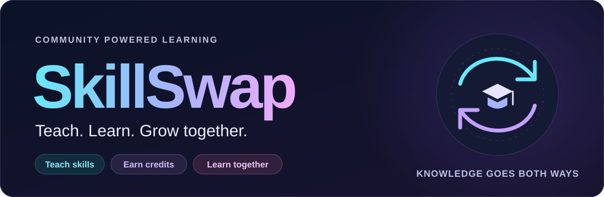
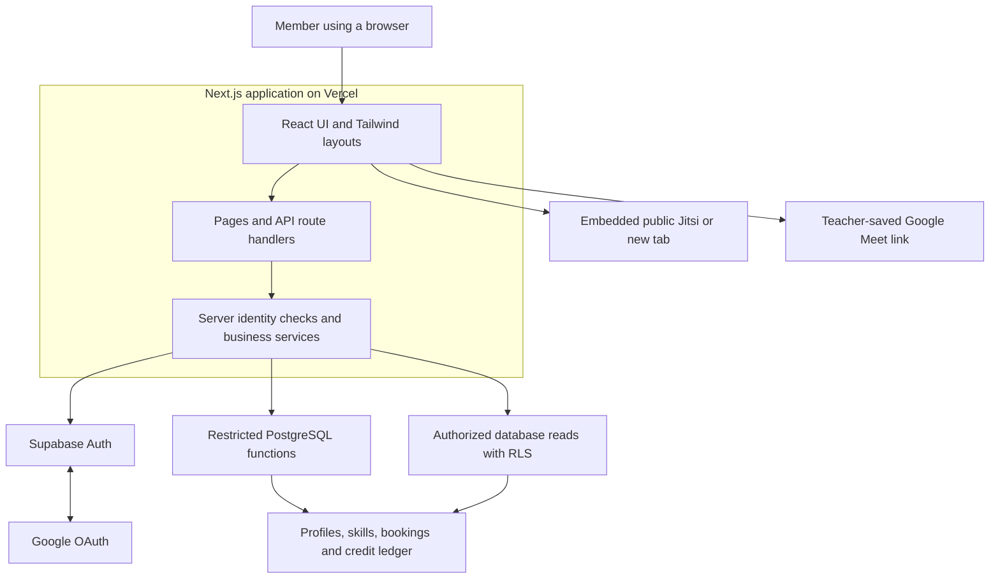
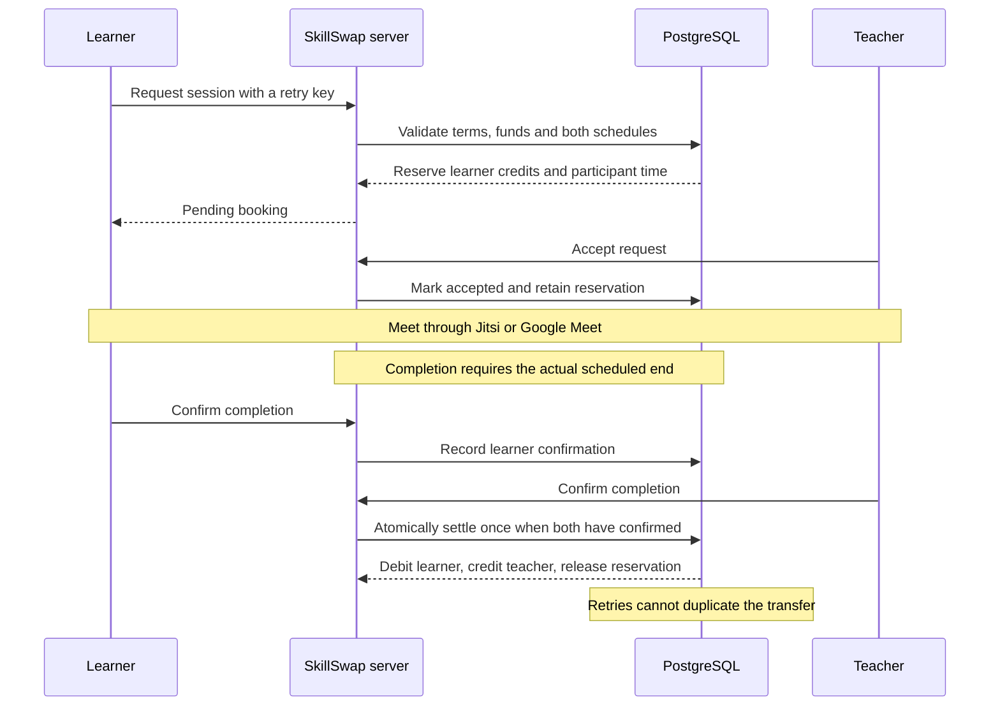
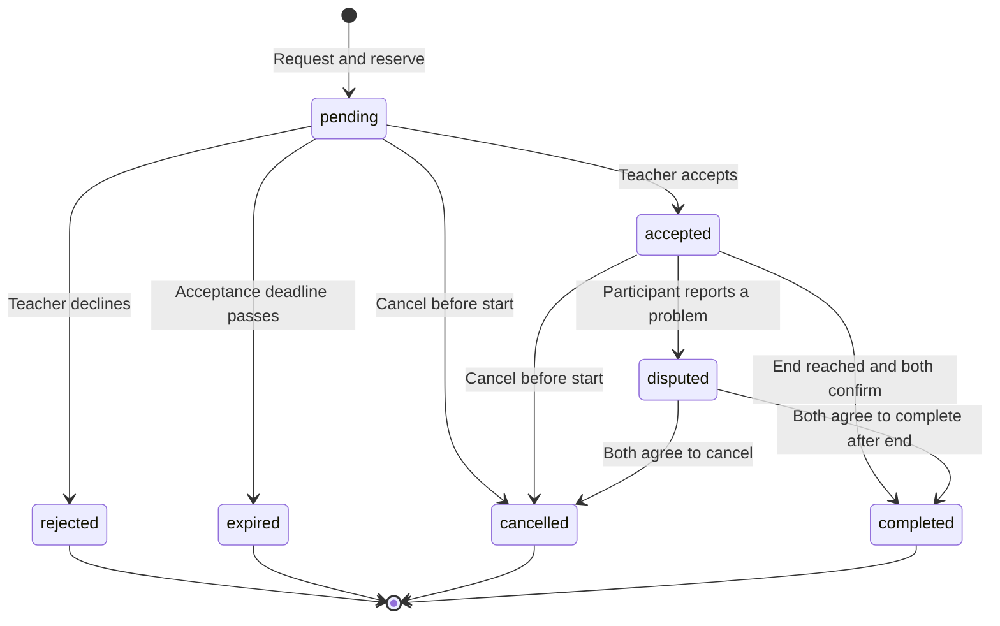

# SkillSwap



**Teach what you know. Learn what you need. Exchange time credits.**

SkillSwap is a community platform for one-to-one skill exchanges. Members choose skills they can teach and skills they want to learn, discover partners, book sessions, meet through Jitsi or Google Meet, and exchange credits after mutual completion. The same person can teach in one booking and learn in another.

**Live application:** [skillswap-comm.vercel.app](https://skillswap-comm.vercel.app)

The previous address redirects to the new one. Sign in again on the new hostname because browser sessions belong to their original hostname.

## The problem behind SkillSwap

People often have useful knowledge to share but cannot afford expensive courses or private tutoring for the next skill they need. Free resources such as YouTube make information accessible, but self-paced learning often leaves the learner responsible for creating a schedule, staying consistent and finding answers when stuck. Without a learning partner or an agreed commitment, it can be easy to watch passively, jump between topics or stop before making progress.

SkillSwap addresses both affordability and learning discipline: members earn access through teaching, while scheduled sessions with another person provide structure, interaction and accountability. Informal exchanges can still be difficult to arrange, and a direct swap requires both people to want exactly what the other offers.

For example, someone who teaches Python may want to learn design, while a designer wants help with guitar. A direct Python-for-design swap does not meet both people's needs. There may still be a useful exchange across the wider community.

SkillSwap separates earning from spending: teach one person to earn credits, then use those credits to learn from another. Booking, reservations and shared completion rules give the exchange a clear process.

## The proposed solution

SkillSwap combines three ideas:

- **Affordable access:** contribute your knowledge to earn credits, then use them to learn without purchasing a course through the platform.
- **Shared accountability:** agree on a time, meet a learning partner and participate actively instead of relying entirely on self-paced viewing.
- **Learning by teaching:** explaining a topic encourages you to organize your knowledge, answer questions and notice gaps in your own understanding.

1. **Create a profile:** sign in, introduce yourself and choose your timezone.
2. **Choose skills:** select or add skills you offer and skills you want to learn.
3. **Discover teachers:** find members whose offered skills match your wanted skills.
4. **Book a session:** review the skill, schedule and credit cost before requesting.
5. **Meet:** after acceptance, use embedded Jitsi or a teacher-saved Google Meet link.
6. **Confirm completion:** both participants confirm after the scheduled end; credits transfer once.
7. **Leave feedback:** completed standard sessions can receive participant reviews.

### Why both participants benefit

The learner receives direct explanation, conversation and a scheduled opportunity to practise. The teacher reinforces their own understanding by explaining and answering questions, while earning credits for their next learning session. Teaching is therefore part of the learning experience: knowledge moves in both directions across the community, and everyone can grow through both roles.

Credits are an internal exchange unit, with no purchase, cash withdrawal or payment gateway in the current implementation. A balance does not guarantee that a suitable teacher will be available.

## Release status

The live application uses the preserved working demo source. The owner has demonstrated Google onboarding, a Jitsi call and a 0.5-credit transfer leaving learner/teacher balances of 2.5 and 3.5 credits.

| Status | What it includes |
| --- | --- |
| **Live demo** | Authentication, profiles, custom skills, skill matching, responsive navigation, scheduling, reservations, wallets, mutual completion, Jitsi, teacher-saved Meet links, feedback and administration |
| **Implemented and tested; awaiting rollout** | Opt-in availability, booking notifications, active/history booking views, additional session refresh fixes, password recovery, restricted support cancellation, an expiry worker and a prepared CI workflow on [`product-upgrade`](https://github.com/sonalreji7/skillswap/tree/product-upgrade) |
| **Future ideas** | Better matching, demand requests, reputation/abuse controls and more capable video infrastructure; these are proposals without promised release dates |

The working application source is preserved under Git tag `demo-working-2026-10-11`, with merged-release backup branch `demo-backup-2026-10-11`. Production remains on the existing Vercel Hobby project. Git pushes do not currently deploy automatically.

Hosted Supabase retains 16 applied migrations and 12 public application tables. The upgrade adds two migrations and two tables; those additions are tested locally and have not been applied to production. See the [upgrade and rollback guide](https://github.com/sonalreji7/skillswap/blob/product-upgrade/docs/PRODUCT_UPGRADE.md) before releasing that branch.

## System architecture

Frontend and backend are organized separately inside one Next.js application. Supabase provides authentication and PostgreSQL. Video runs through external providers.



API handlers validate requests and obtain the authenticated identity. Database functions enforce important booking and financial rules inside transactions. Row Level Security (RLS) limits which records a member can read. The browser cannot choose its own trusted user identity, credit balance or settlement amount.

Google account authentication and Google Meet are separate integrations: signing in through Google does not automatically create a Meet room.

## Technology stack and responsibilities

Versions below describe the repository's current dependency declarations.

| Technology | How SkillSwap uses it |
| --- | --- |
| **Next.js 16 / App Router** | Routes pages, renders server-backed views and runs HTTP API/callback handlers in the same application |
| **React 19** | Interactive forms, navigation, booking actions, provider controls and countdowns |
| **TypeScript 5** | Shared data contracts and compile-time checks across frontend, backend and database clients |
| **Tailwind CSS 4** | Responsive layouts, stacked mobile forms, readable cards and reusable styles |
| **Zod 4** | Runtime validation of request bodies, query parameters and selected response data; rejects unsupported fields |
| **Supabase Auth** | Google OAuth and email/password sessions, confirmation and identity verification |
| **Google Cloud OAuth** | Registers the Google sign-in client and its authorized Supabase callback; its credentials are configured in Supabase |
| **Supabase JS 2 + SSR helpers** | Cookie-aware server clients, database reads and calls to restricted database functions |
| **PostgreSQL on Supabase** | Persistent profiles, skills, bookings, reservations, wallets, balanced ledger entries and feedback |
| **SQL functions, RLS and constraints** | Participant access, overlap prevention, one-time grants, retries and financial consistency |
| **Jitsi Meet** | Embedded public video calls, device controls and a new-tab fallback without a video API key |
| **Google Meet links** | A second call option: the teacher supplies a meeting link and participants open it externally |
| **Vercel** | Hosts the dynamic Next.js application and API handlers over HTTPS |
| **Node.js 24.5+ and npm** | Runtime tooling, scripts and reproducible installation through the lockfile |
| **Supabase CLI and Docker** | Isolated local PostgreSQL/Auth services and versioned migration development |
| **Local mail inbox** | Receives authentication messages during local testing; it is not production SMTP |
| **Vitest, Playwright and ESLint** | Unit checks, real local integration/browser tests, mobile workflows and code checks |

## Main features

### Identity, profiles and skills

- Google sign-in reads actual provider availability from Supabase settings.
- Email/password authentication exists; hosted signup confirmation requires working email delivery. Google onboarding is the verified access path for the demo.
- Members have a display name, bio, optional Organization and IANA timezone.
- Teaching and learning selections are independent, with up to 20 skills per direction.
- Missing skills can be added with a category including Other. Normalized names share one catalogue identity; administrators can disable entries.
- New custom skills are limited to 10 per member per rolling 24 hours. Reusing an enabled skill does not consume that creation allowance.

### Discovery and scheduling

Discovery finds members offering a skill the learner wants, excludes the learner and uses stable pagination. Matching currently uses offered/wanted skills; proficiency and availability ranking remain future work.

| Booking mode | Timing and acceptance |
| --- | --- |
| **Schedule for later** | Start between 15 minutes and 30 days ahead; pending requests expire after 24 hours or at the start, whichever comes first |
| **Start now** | Teacher has five minutes to accept; formal start is request time + five minutes, and calls open immediately after acceptance |
| **Admin-enabled Demo session** | Teacher has one minute to accept; formal start is request time + one minute, followed by the configured actual duration |

Standard sessions last 30, 60 or 90 minutes. Both participants' time is reserved, including across teaching and learning roles, to prevent overlaps. Participants see the schedule in their saved timezone. Either participant can cancel before the formal start.

**The five-minute Start now deadline is not a SkillSwap video-duration limit.** Early joining does not move the financial completion deadline forward.

### Credits and settlement

Verified, onboarded members receive **3 starter credits once**. Ordinary pricing is:

| Standard duration | Credit cost | Internal minute units |
| --- | --- | --- |
| 30 minutes | 0.5 credits | 30 |
| 60 minutes | 1 credit | 60 |
| 90 minutes | 1.5 credits | 90 |

One credit represents 60 minute units for ordinary sessions. Wallets show total, reserved and available amounts. A reservation reduces availability while keeping ownership with the learner until settlement.



Rejection, pending expiry and permitted cancellation release reservations. A dispute keeps funds held until both participants agree to complete or cancel. The live release has no automatic deadline that forces a disputed payment. Video join/leave events and countdowns never authorize a credit transfer.

The database uses transaction locks, occupancy constraints, unique issuance/transfer events and balanced append-only ledger entries. Financial consistency is checked when transactions finish. This protects against duplicate clicks and competing requests; it does not prove useful teaching occurred.

### Booking lifecycle



This diagram describes the live participant flow. Restricted admin recovery is part of the unreleased upgrade, not an additional live settlement path.

### Video, feedback and administration

**Jitsi:** accepted, funded participants can prepare an embedded public room or open it in a new tab. The app checks identity, booking state and join eligibility. Standard access opens ten minutes before start and closes fifteen minutes after end; accepted quick/demo sessions can join immediately. Public Jitsi controls its own host authentication and duration policies.

**Google Meet:** the teacher creates a meeting externally and saves its standard HTTPS meeting-code link. SkillSwap stores it for authorized participants and enables joining during the call window. Google handles sign-in, admission, devices and call limits. There is no automatic Meet creation or attendance API integration.

**Feedback:** each participant can submit one immutable 1–5-star review after a completed standard session. Received reviews contribute to reputation. Community ranking requires at least three received ratings. Demo sessions cannot publish reputation feedback.

**Administration:** trusted admins manage member suspension/restoration, administrator roles, skills, feedback visibility, booking/wallet summaries and dispute review notes. Changes require a reason and immutable audit records. Privileges come from private database membership, never editable user metadata. The panel has no arbitrary credit grants, forced settlement or impersonation.

**Fast credit-transfer demo:** an admin can enable 1–10 actual minutes and a cost of 0.5–3 credits in 0.5-credit increments. Learners explicitly select Demo session; terms are saved with the booking and later policy edits do not change them. A one-minute/0.5-credit demo becomes eligible for completion about two minutes after requesting. Both confirmations still transfer real reserved credits once. See the [two-person walkthrough](docs/CLASSROOM_DEMO.md).

## Development challenges and resolutions

| Challenge | How it was addressed |
| --- | --- |
| **Google login was missing or unavailable** | Displayed a Google option, checked actual provider availability and configured a Google OAuth web client in Supabase. Supabase OAuth Server settings are a different feature and do not enable Google account sign-in. |
| **Local Auth settings did not match hosting** | Aligned application `SITE_URL`, Supabase Site URL and exact callbacks. The friendly-domain change retained old callback entries and added new ones without replacing Google credentials. |
| **A teacher's Meet link would not save** | Common copied links included sharing parameters/fragments. Added server/client normalization of genuine HTTPS meeting-code URLs before canonical storage; lookalike hosts and malformed links remain rejected. |
| **Learners still saw no link after a save** | Added five-second/focus refresh and manual refresh, prevented stale reads from overwriting saves, preserved unsaved teacher input and cleared access for removed/replaced links. |
| **Counting time with Meet in another tab** | Displayed a shared countdown using database server time and the original booking schedule. Reloading does not restart it. It measures scheduled time, not attendance or actual Google call duration. |
| **Jitsi required first-host signup** | Disclosed the provider requirement, supplied a new-tab fallback and offered Meet alongside it. SkillSwap cannot remove external authentication requirements or duration limits. |
| **The original video option required credentials/infrastructure** | Replaced the active Daily path with public Jitsi and teacher-saved Meet links. Historical applied migrations remain intact; no active Daily API/key is required. |
| **Normal sessions were too long for a transfer demonstration** | Added versioned admin Demo settings with short real durations and selected costs. Actual end time and both confirmations remain required; no fake clocks or balances are used in the live feature. |
| **Duplicate clicks/concurrent actions could duplicate payments** | Used retry keys, transactions, unique ledger events and reservation reconciliation. Settlement retries return the existing result rather than paying again. |
| **Database protection rejected a Demo settings update** | Added a separate migration with an explicit singleton-row filter for PostgREST safe-update enforcement, preserving applied migration history. |
| **Forms and navigation were awkward on phones** | Added a compact Menu, stacked controls, full-width actions, wrapping names and visible selection chips. Browser checks include 320px layouts. |
| **Missing catalogue skills blocked useful matches** | Added normalized custom skills, Other, reuse/moderation rules and a database-enforced creation allowance. |
| **Credentials on another computer were unavailable in the cloud** | Used secure management environment bindings, ignored local configuration and environment-switch helpers. Credentials and the original prompt are excluded from Git and uploads. |
| **Google worked but email confirmation remained limited** | Preserved Google access and documented the need for a real SMTP sender. The pending upgrade gates hosted email signup/recovery until delivery is configured and tested. |
| **Cloud network rules blocked some provider/public checks** | Verified settings through permitted management APIs and saved the new-hostname rule for environment publication. Configuration checks are reported separately from actual browser/media verification. |

### Google configuration and Meet links

Google login uses two different callbacks. The Google Cloud OAuth client redirects to `https://<project-ref>.supabase.co/auth/v1/callback`. Supabase then returns the user to SkillSwap's exact `/auth/callback` URL. Its Site URL and callback allowlist must match the deployed app origin. The Google client ID and secret belong in Supabase's Google provider settings, not in public browser variables.

Meet uses a teacher-supplied link instead of that login flow. A copied link such as `https://meet.google.com/xxx-xxxx-xxx?authuser=0` is normalized to its canonical meeting-code URL before storage. Both participants read the saved link from SkillSwap; opening it does not generate a room, bypass Google admission or provide attendance data.

## Current limitations

- **Video privacy and duration:** public Jitsi and external Meet links can be shared outside the app. SkillSwap cannot revoke copied links or enforce provider-side participant-only admission. The exact current public Jitsi duration cap has not been independently verified here.
- **Attendance and learning quality:** a countdown, call-access grant and two confirmations do not prove attendance or successful teaching. No trustworthy provider attendance telemetry is collected.
- **Unresolved disputes:** the live release retains holds until participant agreement. Staff review notes cannot resolve a dispute or move funds. Restricted support cancellation is on the pending upgrade branch.
- **Demand and trust:** matching depends on available teachers. Email verification cannot prevent every duplicate account, and collusion can influence reviews. Equal-duration standard sessions cost the same despite differences in expertise.
- **Email delivery:** production SMTP remains an external requirement. Password recovery exists on the upgrade branch, but is not a released, verified hosted email flow.
- **Expiry without user activity:** live expiry occurs during relevant reads/actions. A scheduled worker is prepared in the upgrade and is not running on production yet.
- **Scale:** financial routines share an advisory lock, and the skill editor loads the full catalogue. These need refinement for a much larger community.
- **Verification gaps:** actual Meet media, fresh-environment restoration and end-to-end login on the new hostname remain separate checks. The owner-reported Jitsi/transfer demo is distinct from automated local tests. The pending CI workflow has not had a verified remote run.
- **Dependency maintenance:** the latest review found a development-only `braces` advisory without a compatible published patch at that time; production audit was clean. Dependency checks remain ongoing maintenance.

## Coming next and longer-term roadmap

### Next release: implemented, awaiting rollout

The [`product-upgrade` branch](https://github.com/sonalreji7/skillswap/tree/product-upgrade) contains:

- Expiring **15/30/60-minute availability** and available-now discovery.
- Private transactional **booking notifications**, read controls and unread badges.
- Clearer **active/history booking views**, partner/skill names and automatic refresh.
- Protected-page cookie refresh and timestamp-precision-safe pagination.
- Password recovery and session revocation, with hosted email gated on tested SMTP.
- Audited support cancellation by an uninvolved admin for eligible held accepted/disputed bookings after 24 hours past the end or when a participant is suspended. It cannot force payment or change settled balances.
- A restricted expiry worker, an opt-in one-minute Cron helper, safer diagnostics and a prepared GitHub checks workflow.

Rollout requires reviewed additive migrations, deliberate scheduler/email configuration where applicable, deployment and hosted checks. These are upcoming changes, not features already available on the live site.

### Later possibilities: proposed, not scheduled

- A **request-a-skill board** to reveal unmet demand and help teachers find opportunities.
- Matching by proficiency, availability and timezone, with understandable ranking criteria.
- Reputation using unique partners and reduced repeated-pair influence.
- Signup-abuse review and clearer no-show/dispute policies.
- Private video infrastructure or authenticated admission and server attendance events.
- Server-side catalogue search and finer database locking for higher traffic.

Variable teacher pricing, group sessions and purchased credits would change the financial model and require separate design and authorization. They are not enabled by this roadmap. No release dates are promised.

## Repository layout

```text
skillswap/
├── src/
│   ├── app/             # Pages, API routes and Auth callbacks
│   ├── frontend/        # React components and interaction flows
│   ├── backend/         # Identity checks and business services
│   └── shared/          # Types and runtime validation
├── supabase/
│   ├── migrations/      # Versioned SQL schema and business rules
│   └── templates/       # Authentication email templates
├── scripts/             # Local environment and hosted-management helpers
├── tests/               # Unit, integration and browser checks
├── docs/                # Detailed contracts, setup and progress
└── .local/              # Ignored prompt, credentials and local tooling
```

The original prompt stays in ignored `.local/PROJECT_PROMPT.txt`. Real environment files, credentials, generated output and local reports are excluded from Git and deployment uploads.

## Run locally

Prerequisites: Node.js **24.5+**, npm and a running Docker daemon. From the repository root:

```sh
npm ci --cache /tmp/skillswap-npm-cache
npm run db:start
npm run supabase -- migration up --local
node scripts/environment.mjs prepare-tests
npm run env:local
npm run dev -- --hostname 0.0.0.0
```

Open **http://127.0.0.1:3000**, matching local `SITE_URL`. The local mail inbox is at **http://127.0.0.1:54324**. Email confirmation is enabled; confirm before onboarding. Helpers preserve user-managed `.env.local` files rather than overwriting them. If switching is refused, back up your configuration before choosing a new active environment.

The Supabase helper uses pinned official slim images and configures local networking while preserving external HTTPS proxy settings. `npm run db:stop` retains ordinary local data; never reset a database you need to preserve. Future tasks still need services restarted; fresh-task restoration has not been verified.

For hosted development, follow [Supabase setup](docs/SUPABASE_SETUP.md). Use the public publishable/anon key in the app; management tokens and service-role keys must not be browser variables. `SITE_URL` must match the actual origin, with corresponding exact Supabase callbacks.

`hosted:migrate` and `hosted:configure` change the remote project. They are deliberate release operations, not local quick-start steps. Never configure hosted Auth to a local origin merely to run isolated tests.

## Validation

```sh
npm test                  # Unit tests
npm run check             # Lint, route types, TypeScript and production build
npm run test:integration   # Real local Auth/PostgreSQL integration checks
npm run test:e2e           # Full Playwright suite, including browser workflows
```

Install Chromium with `npx playwright install chromium`, or use the existing cloud executable:

```sh
PLAYWRIGHT_CHROMIUM_EXECUTABLE_PATH=/usr/bin/chromium npm run test:e2e
```

Tests load `.local/local.env`, require loopback services and refuse hosted account creation. Leave the test app port free and stop task test/dev servers before building. Some tests adjust local timing fixtures; those are not claims of real elapsed hosted sessions or real provider media. The short timed demo test separately verifies actual local elapsed time and exact-once transfer with normal starter grants.

The preserved release has passing unit/build and integration/mobile evidence in [progress](docs/PROGRESS.md). The upgrade has 39 passing unit tests and passing evidence for 32 distinct local integration/browser cases across full and focused runs. Automated checks do not establish external email delivery, Google account interaction or physical-phone video quality.

## Further documentation

- [Product specification and adopted rules](PROJECT_SPEC.md)
- [API contract](docs/API_CONTRACT.md)
- [Database design](docs/DATABASE_SCHEMA.md)
- [Supabase setup](docs/SUPABASE_SETUP.md)
- [Administration](docs/ADMIN.md)
- [Two-person demo walkthrough](docs/CLASSROOM_DEMO.md)
- [Deployment history and setup](docs/DEPLOYMENT.md)
- [Development progress](docs/PROGRESS.md)
- [Current domain and rollback notes](https://github.com/sonalreji7/skillswap/blob/friendly-url/docs/FRIENDLY_URL.md)
- [Pending upgrade rollout and rollback](https://github.com/sonalreji7/skillswap/blob/product-upgrade/docs/PRODUCT_UPGRADE.md)

The current URL and release status here supersede older statements in historical phase notes. Roll back application code without resetting accounts, migration history or legitimate transfers; use a retained deployment whose captured `SITE_URL` matches the canonical domain.
